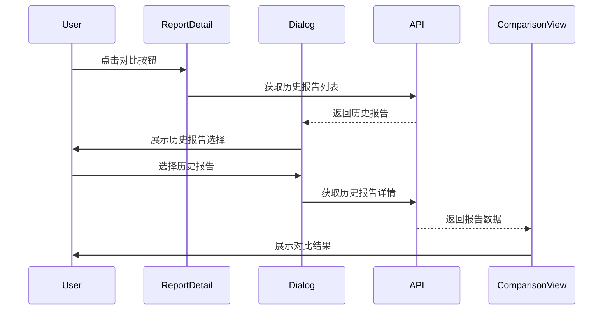

# Design Document: Report Comparison Feature

## Overview

本设计文档描述了压测报告对比功能的技术实现方案。该功能允许用户在压测结束后（status=4），选择同一测试计划的历史报告与当前报告进行性能指标对比，帮助用户快速识别性能变化趋势。

## Architecture

### 整体架构

```mermaid
graph TB
    subgraph Frontend
        RD[ReportDetail.vue] --> CB[ComparisonButton]
        CB --> HRD[HistoricalReportDialog]
        HRD --> RCS[ReportComparisonService]
        RCS --> CV[ComparisonView]
        CV --> SM[SummaryMetrics]
        CV --> SC[SceneComparison]
        SC --> CC[CaseComparison]
    end
    
    subgraph API
        RCS --> API[Report API]
        API --> BE[Backend Service]
    end
```

### 数据流



## Components and Interfaces

### 1. ReportComparisonButton 组件

位置: `taishan-fe/src/views/Report/component/ReportComparisonButton.vue`

```typescript
interface Props {
  reportId: number
  planId: number
  disabled: boolean
}

interface Emits {
  (e: 'compare', targetReportId: number): void
}
```

### 2. HistoricalReportDialog 组件

位置: `taishan-fe/src/views/Report/component/HistoricalReportDialog.vue`

```typescript
interface Props {
  visible: boolean
  planId: number
  currentReportId: number
}

interface Emits {
  (e: 'update:visible', value: boolean): void
  (e: 'confirm', reportId: number): void
}

interface HistoricalReportItem {
  report_id: number
  start_time: string
  end_time: string
  create_user_name: string
  total_request_num: number
  total_success_rate: number
}
```

### 3. ReportComparisonView 组件

位置: `taishan-fe/src/views/Report/component/ReportComparisonView.vue`

```typescript
interface Props {
  currentReport: ReportData
  targetReport: ReportData
  currentReportDetail: ReportDetail
  targetReportDetail: ReportDetail
  sceneNameMap: Record<number, string>
  caseNameMap: Record<number, string>
}

interface Emits {
  (e: 'close'): void
}
```

### 4. ComparisonMetricCard 组件

位置: `taishan-fe/src/views/Report/component/ComparisonMetricCard.vue`

```typescript
interface Props {
  label: string
  currentValue: number | string
  targetValue: number | string
  unit?: string
  higherIsBetter: boolean  // true: 值越高越好(如RPS), false: 值越低越好(如RT)
}
```

### 5. SceneComparisonTable 组件

位置: `taishan-fe/src/views/Report/component/SceneComparisonTable.vue`

```typescript
interface Props {
  currentScenes: SceneData[]
  targetScenes: SceneData[]
  sceneNameMap: Record<number, string>
  caseNameMap: Record<number, string>
}

interface SceneComparisonItem {
  scene_id: number
  scene_name: string
  status: 'matched' | 'added' | 'removed'
  current?: SceneMetrics
  target?: SceneMetrics
}

interface SceneMetrics {
  concurrency: number
  total_rps: number
  total_avg_rt: number
  total_success_rate: number
  cases: CaseMetrics[]
}
```

## Data Models

### ComparisonResult 数据模型

```typescript
interface ComparisonResult {
  summary: SummaryComparison
  scenes: SceneComparisonItem[]
}

interface SummaryComparison {
  total_request_num: MetricComparison
  total_success_rate: MetricComparison
  total_rps: MetricComparison
  total_avg_rt: MetricComparison
  total_send_bytes: MetricComparison
  total_received_bytes: MetricComparison
}

interface MetricComparison {
  current: number
  target: number
  diff: number
  diffPercent: number
  trend: 'up' | 'down' | 'same'
  isImproved: boolean
}

interface CaseComparisonItem {
  case_id: number
  case_name: string
  status: 'matched' | 'added' | 'removed'
  current?: CaseMetrics
  target?: CaseMetrics
}

interface CaseMetrics {
  total_rps: number
  total_avg_rt: number
  total_success_rate: number
  ninety_request_time_line_value: number
  ninety_five_request_time_line_value: number
  ninety_nine_request_time_line_value: number
}
```

### 工具函数

```typescript
// 计算指标对比
function calculateMetricComparison(
  current: number,
  target: number,
  higherIsBetter: boolean
): MetricComparison {
  const diff = current - target
  const diffPercent = target !== 0 ? (diff / target) * 100 : 0
  const trend = diff > 0 ? 'up' : diff < 0 ? 'down' : 'same'
  const isImproved = higherIsBetter ? diff > 0 : diff < 0
  
  return { current, target, diff, diffPercent, trend, isImproved }
}

// 匹配场景
function matchScenes(
  currentScenes: SceneData[],
  targetScenes: SceneData[]
): SceneComparisonItem[] {
  const result: SceneComparisonItem[] = []
  const targetMap = new Map(targetScenes.map(s => [s.scene_id, s]))
  const matchedIds = new Set<number>()
  
  // 处理当前报告中的场景
  for (const scene of currentScenes) {
    const target = targetMap.get(scene.scene_id)
    if (target) {
      matchedIds.add(scene.scene_id)
      result.push({
        scene_id: scene.scene_id,
        status: 'matched',
        current: extractSceneMetrics(scene),
        target: extractSceneMetrics(target)
      })
    } else {
      result.push({
        scene_id: scene.scene_id,
        status: 'added',
        current: extractSceneMetrics(scene)
      })
    }
  }
  
  // 处理仅在目标报告中存在的场景
  for (const scene of targetScenes) {
    if (!matchedIds.has(scene.scene_id)) {
      result.push({
        scene_id: scene.scene_id,
        status: 'removed',
        target: extractSceneMetrics(scene)
      })
    }
  }
  
  return result
}

// 过滤历史报告（排除当前报告）
function filterHistoricalReports(
  reports: HistoricalReportItem[],
  currentReportId: number
): HistoricalReportItem[] {
  return reports.filter(r => r.report_id !== currentReportId)
}
```

## Correctness Properties

*A property is a characteristic or behavior that should hold true across all valid executions of a system-essentially, a formal statement about what the system should do. Properties serve as the bridge between human-readable specifications and machine-verifiable correctness guarantees.*

### Property 1: Historical Report Exclusion

*For any* list of historical reports and current report_id, filtering the list should produce a result that does not contain the current report_id.

**Validates: Requirements 1.5**

### Property 2: Metric Comparison Calculation

*For any* two numeric values (current and target), the calculated difference should equal current - target, and the percentage change should equal ((current - target) / target) * 100 when target is non-zero.

**Validates: Requirements 2.3**

### Property 3: Metric Improvement Detection

*For any* pair of metric values and a higherIsBetter flag:
- When higherIsBetter is true, isImproved should be true if current > target
- When higherIsBetter is false, isImproved should be true if current < target

**Validates: Requirements 2.4, 2.5**

### Property 4: Scene/Case Matching Completeness

*For any* two lists of scenes (or cases), the matching algorithm should:
- Mark items present in both lists as 'matched'
- Mark items only in current as 'added'  
- Mark items only in target as 'removed'
- The union of matched, added, and removed items should equal the union of both input lists

**Validates: Requirements 3.1, 3.3, 4.1, 4.3**

### Property 5: Report Data Preservation

*For any* report data, opening and closing the comparison view should not modify the original report data (data invariant).

**Validates: Requirements 5.3**

## Error Handling

### API 错误处理

1. **获取历史报告列表失败**
   - 显示错误提示: "获取历史报告失败，请重试"
   - 禁用对比按钮

2. **获取报告详情失败**
   - 显示错误提示: "获取报告数据失败，请重试"
   - 关闭对比对话框

3. **无历史报告可对比**
   - 显示提示: "暂无其他历史报告可供对比"
   - 禁用确认按钮

### 数据异常处理

1. **场景/接口不匹配**
   - 正常显示，标记为"新增"或"已移除"

2. **数值为空或无效**
   - 显示 "--" 或 "N/A"
   - 不计算差异百分比

## Testing Strategy

### 单元测试

使用 Vitest 进行单元测试：

1. **工具函数测试**
   - `calculateMetricComparison` 函数的计算正确性
   - `matchScenes` 函数的匹配逻辑
   - `filterHistoricalReports` 函数的过滤逻辑

2. **组件测试**
   - ComparisonMetricCard 的颜色显示逻辑
   - HistoricalReportDialog 的选择状态管理

### 属性测试

使用 fast-check 进行属性测试：

1. **Property 1**: 测试历史报告过滤
2. **Property 2**: 测试指标差异计算
3. **Property 3**: 测试改进检测逻辑
4. **Property 4**: 测试场景/接口匹配算法
5. **Property 5**: 测试数据不变性

每个属性测试运行至少 100 次迭代。

### 集成测试

1. 完整的对比流程测试
2. API 调用和数据渲染测试
